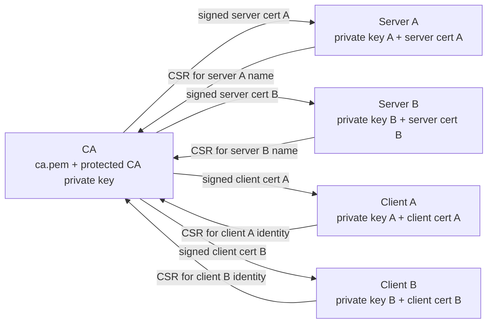
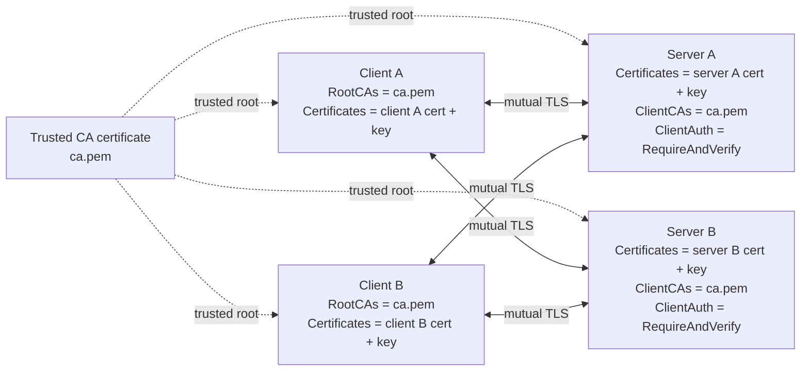
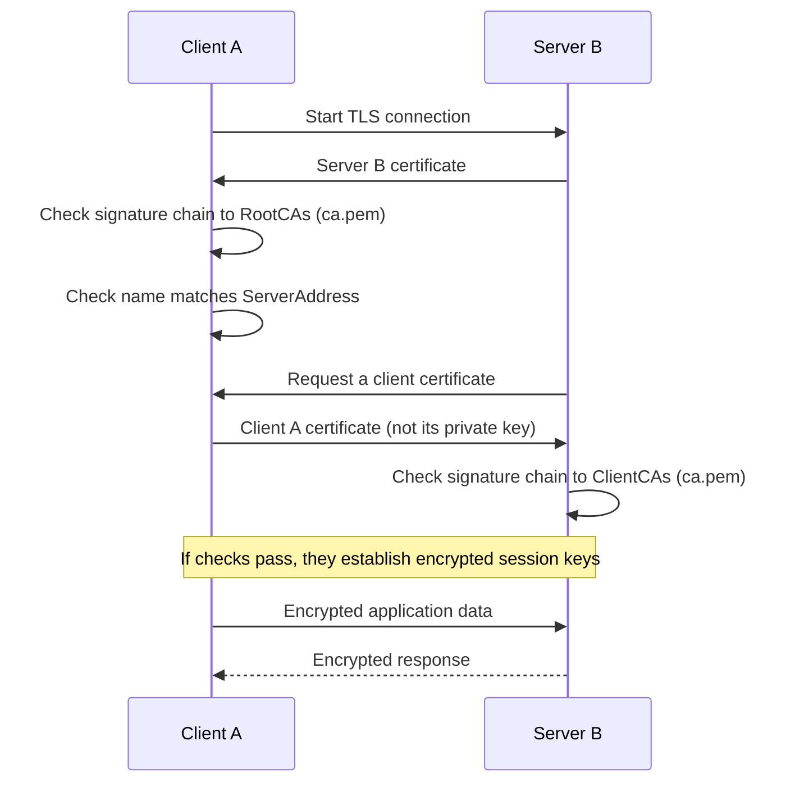

# TLS: certificate lifecycle

Think of a CA (certificate authority) as the identity office for your services.
It signs certificates. A certificate is public and says, “this key belongs to
this identity”; the matching private key proves the identity. **Each process
keeps its own private key secret.** Peers share certificates and trust the CA,
not each other's private keys.

## 1. Issue identities

Every server and client gets its own key and certificate. It sends a
certificate signing request (CSR) to the CA; the CA signs it and returns a
certificate. The CA's private signing key stays with the CA.

The server certificate must include the host name clients will use. For this
repo's current example, [`server-csr.json`](../../test/server-csr.json) includes
`localhost` and `127.0.0.1`. The [`gencert` target](../../Makefile) currently
creates one CA and one server certificate; the second server and the client
certificates above illustrate what each additional process needs.

## Where the CA files come from

For local development, run `make gencert`. The target uses CFSSL and
[`ca-csr.json`](../../test/ca-csr.json) to create the CA, then uses that CA to
sign a server certificate. It moves the generated files into `CONFIG_PATH`,
which defaults to `~/.proglog`:

- `ca.pem` is the public CA certificate. Configure this as `CAFile` on every
  process that needs to verify certificates signed by this CA.
- `ca-key.pem` is the CA's **private signing key**. The local target puts it in
  the same directory, but it must be kept secret and must not be copied to
  application clients or servers.
- `server.pem` and `server-key.pem` are the server's certificate and private
  key. Give these to that server; the private key must remain secret.

This Makefile target is a development convenience, not production key
management: it generates the CA key locally and places it alongside the
server's files. In production, keep the CA signing key in a separately
protected CA system or secret store, and distribute only the public `ca.pem`
and each process's own certificate and private key. The current target creates
only one server certificate; client certificates must also be issued for mTLS.

### What separation looks like in production

The CA is a controlled signing service, not something every application
server runs. For example, an organization may keep a root CA offline and use
it to authorize an intermediate CA. The intermediate can handle routine
certificate requests, while the root key is used rarely. A managed CA or a
CA backed by an HSM can protect signing keys and limit who or what is allowed
to use them.

The root CA's private key is especially sensitive: because systems trust the
root, someone who steals that key could issue certificates that appear trusted
by those systems. Keeping it offline means it is not available to ordinary
network-connected services; it is brought out under controlled procedures
only when needed, such as to authorize or renew an intermediate CA. The
intermediate's online key handles routine issuance, limiting exposure of the
root key. The root **certificate** is public and can still be distributed to
services as a trust anchor; it is the root **private key** that stays offline.

The usual issuance flow is:

1. A service creates its own private key on the machine or platform where it
   will run. The private key stays there and is never sent to the CA.
2. The service sends a CSR containing its public key and requested identity
   (for a server, its DNS names) to the CA.
3. The CA authenticates the requester, checks that it is allowed to claim
   that identity, and signs an approved certificate.
4. The service receives its certificate (and any needed intermediate
   certificates). It installs those alongside its private key. Peers receive
   the CA certificate or chain they need to trust it.
5. Before certificates expire, the service repeats the process and reloads
   the renewed certificate. If a key or certificate is compromised, operators
   replace it and use their organization's revocation and trust-update
   procedures.

That means the CA handles signing, but it does not need to be contacted for
each TLS connection. During a connection, each peer verifies the certificate
locally using its configured trust pool. The CA private key never goes to the
application services; each service receives only its own key and certificate,
plus public CA certificates needed to verify peers.

## 2. Install certificates and trust

Each process gets its own certificate and private key. To verify peers, it
also gets the CA certificate (`ca.pem`), which is public. In this example, the
same CA signs every certificate:

- Each client uses `ca.pem` as `RootCAs`, so it trusts servers signed by this
  CA.
- Each server uses `ca.pem` as `ClientCAs`, so it trusts clients signed by
  this CA, and requires each client to present a certificate.

`RootCAs` and `ClientCAs` are trust settings; they do not contain the process's
own identity. `Certificates` contains the process's own certificate and key.
`ServerAddress` tells a client which server name to check in the server
certificate. In [`SetupTLSConfig`](./tls.go), `Server: false` selects the
client behavior, while `Server: true` selects the server behavior.

## 3. What happens when Client A connects to Server B

The same handshake happens for any client/server pair in the diagram:

The two certificate checks go in opposite directions:

1. **Client checks server:** Server B proves it owns its private key and
   presents its certificate. Client A checks that the CA signed it and that
   the name is the one Client A intended to reach.
2. **Server checks client:** Server B requests a client certificate. Client A
   presents its certificate (never its private key). Server B checks that the
   CA signed it. `tls.RequireAndVerifyClientCert` makes this certificate
   mandatory.
3. **Both communicate:** Only after successful checks do they use the TLS
   connection. TLS negotiates encryption keys; the certificates themselves
   are not used to encrypt each message.

If Client A connects to Server A instead, the same checks happen using Server
A's certificate and expected name. If the CA is not trusted, the server name
does not match, or the client certificate is missing/untrusted, the handshake
fails before application data is exchanged.

This two-way verification is **mutual TLS (mTLS)**. For ordinary server-only
TLS, omit the client's certificate and do not configure the server to require
client certificates; the client still verifies the server.
