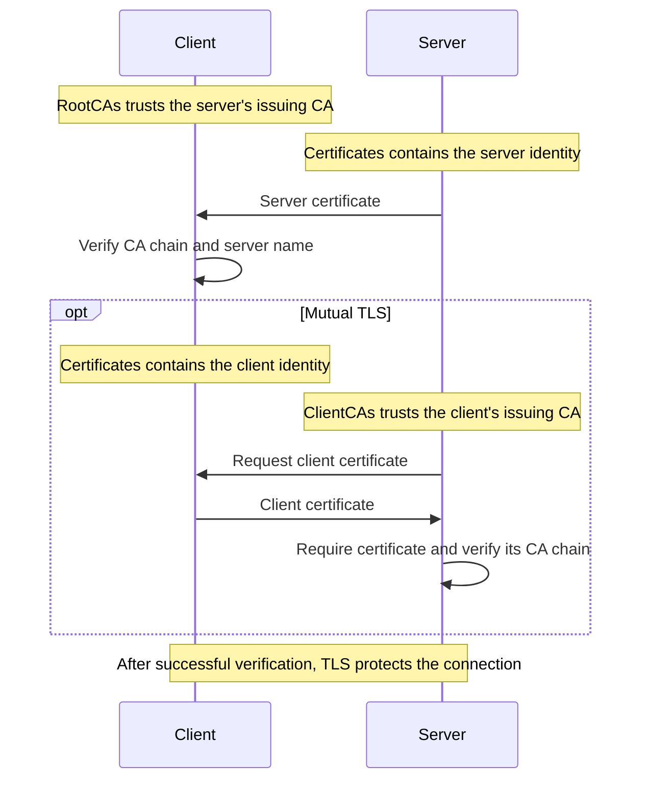

# TLS configuration

TLS lets the client and server prove their identities and then protects the
connection with encryption. A certificate is a signed statement of identity;
the matching private key proves that the process presenting the certificate
owns that identity. A CA (certificate authority) signs certificates. A peer
trusts a certificate when it can validate the signature chain back to a CA it
trusts.

## What `SetupTLSConfig` configures

The `Server` flag determines which side this process will be:

| Field | Client (`Server: false`) | Server (`Server: true`) |
| --- | --- | --- |
| `CertFile` / `KeyFile` | Optional client identity, sent if the server requests a certificate | Server identity, sent to every client |
| `CAFile` | CA certificate(s) trusted to verify the server (`RootCAs`) | CA certificate(s) trusted to verify clients (`ClientCAs`) |
| `ServerAddress` | Expected server name; used to verify the server certificate's name | Not used for the normal server-side identity check |

On the client, the server certificate must chain to a CA in `RootCAs` and match
`ServerAddress`. On the server, `ClientAuth` is set to
`tls.RequireAndVerifyClientCert`: the client must present a certificate, and it
must chain to a CA in `ClientCAs`. When both `CertFile` and `KeyFile` are set,
the function loads them into `Certificates`, the identity this process presents
to its peer.

## What happens during the handshake

The server always presents its certificate. The client checks that it trusts
the issuing CA and that the certificate is for the expected server name. In
mutual TLS (mTLS), the server also requests a client certificate, and checks
that certificate against its trusted client CAs.

If the server certificate is untrusted or has the wrong name, the client
rejects the connection. In mTLS, the server rejects a client that does not
present a certificate trusted by `ClientCAs`.

## The three configurations

### 1. Client verifies the server

The client sets `CAFile` to the CA that issued the server certificate and sets
`ServerAddress` to the server's expected name. The client verifies the server,
but does not present its own certificate.

### 2. Client verifies the server and presents its own certificate

This is the client side of mTLS. Configure the client as in case 1, and also
provide its `CertFile` and `KeyFile`. The client still verifies the server;
the certificate and key let it identify itself when the server requests a
client certificate.

### 3. Server presents its certificate and verifies the client

Set `Server: true`, provide the server's `CertFile` and `KeyFile`, and set
`CAFile` to the CA that issued client certificates. The server presents its
own identity and requires each client to present a certificate trusted by
that CA.

For mTLS, cases 2 and 3 work together: the client trusts the server's CA, and
the server trusts the client's CA. Those may be the same CA or different CAs.
